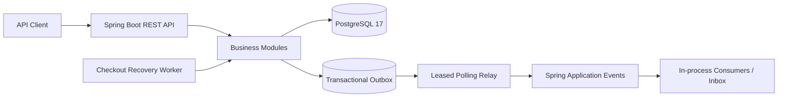
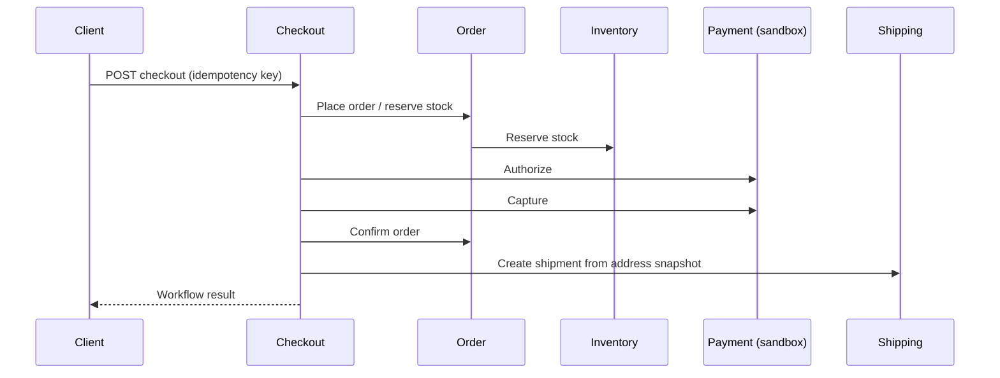

# Architecture Overview

## 1. System intent

Enterprise Order Management (EOM) demonstrates an enterprise-oriented **modular monolith** for customer, catalog, inventory, ordering, payment, shipping, and checkout workflows. The design optimizes for explicit domain ownership, transactional correctness, testability, and a credible path to later extraction—not for maximizing the number of deployable services.

## 2. Runtime context

- One Spring Boot application (Java 25).
- Spring Modulith verifies module boundaries.
- PostgreSQL 17 is the system of record; Flyway owns schema evolution.
- Docker Compose provides the local database.
- GitHub Actions runs Maven verification against PostgreSQL.
- Payment and carrier integrations are deterministic local sandbox implementations; no external provider is contacted.



## 3. Module map and ownership

| Module | Owns | Public collaboration surface |
|---|---|---|
| customer | Customer identity/profile | Customer module API |
| catalog | Product, SKU, price | Catalog module API |
| inventory | Stock and reservation lifecycle | Inventory operations |
| order | Order, line snapshots, order state | Order operations |
| payment | Payment intent and payment state machine | Payment operations |
| shipping | Shipment and delivery-address snapshot | Shipping operations |
| outbox | Event envelope, relay metadata, inbox deduplication | Append/publish operations |
| checkout | Durable checkout workflow and orchestration | Checkout API |

Each module owns its persistence. A module must not query another module's repository or tables. Cross-module calls use the owning module's public API; asynchronous integration uses versioned event envelopes. Spring Modulith verification is part of CI.

## 4. Core workflows

### Direct order lifecycle

1. Validate customer and product references.
2. Reserve inventory atomically.
3. Persist order and immutable line/price snapshots.
4. Confirm consumes reservations; cancellation releases them.
5. Repeated terminal commands are handled idempotently where supported.

### Checkout saga



The workflow persists checkpoints and an immutable delivery-address snapshot. Payment-step failure attempts void/release compensation. Order-confirmation failure after capture attempts refund and reservation resolution. Shipment creation failure does not reverse completed payment or inventory actions: the workflow remains fulfillment-pending and the recovery worker retries using the persisted address snapshot. A failed compensation becomes `COMPENSATION_REQUIRED` and requires operator reconciliation; it is not silently treated as success.

**Important financial boundary:** the current payment gateway is sandbox-only. A provider timeout in a real integration would represent an unknown outcome and must be reconciled by provider reference/idempotency key before retrying a financial command.

## 5. Transactional outbox

Business state and event rows are appended in the same PostgreSQL transaction. A scheduled relay claims bounded batches with `FOR UPDATE SKIP LOCKED`, assigns a worker ID and 120-second lease, then publishes outside the claim transaction. This avoids holding row locks while listeners run and lets concurrent instances claim different rows.

- Batch size: 50 in the scheduled relay (claim API accepts 1–500).
- Lease duration: 120 seconds.
- Poll interval: configurable; default 1,000 ms.
- Retry: exponential backoff, starting at 2 seconds and capped at 1 hour.
- Dead-letter: after 12 failed attempts; rows are excluded from automatic claims.
- Expired leases become eligible for recovery.
- Inbox uniqueness is scoped by consumer and event ID.

Delivery is **at least once**, not exactly once. A process can publish an event and crash before saving its published marker. A lease can also expire during unusually slow publication. Consumers must therefore deduplicate and make their business effects idempotent. The current transport is Spring's in-process event publisher, not Kafka/RabbitMQ.

### Operational query

```sql
SELECT event_id, event_type, aggregate_type, aggregate_id,
       attempts, last_error, locked_by, locked_until, dead_lettered_at
FROM messaging.outbox_events
WHERE dead_lettered_at IS NOT NULL
ORDER BY dead_lettered_at DESC;
```

Use this query for inspection only. Do not manually mark events published or replay them without confirming consumer idempotency and the original business outcome.

## 6. Consistency and failure boundaries

| Boundary | Mechanism | Guarantee / limitation |
|---|---|---|
| Order + inventory | One local PostgreSQL transaction | Atomic within this database |
| Business write + outbox append | Same local transaction | No lost event due to a DB commit/publish gap |
| Outbox → in-process listener | Leased polling | At-least-once; duplicates possible |
| Consumer effect + inbox marker | Same consumer transaction | Duplicate event can be ignored when InboxService is used correctly |
| Checkout across modules | Persisted saga checkpoints | Eventual consistency; compensation may need reconciliation |
| Payment/carrier | Sandbox adapters | No real external side effect currently |

## 7. Quality attributes and trade-offs

- **Consistency:** local ACID transactions are preferred inside the modular monolith; saga compensation is used across workflow steps.
- **Resilience:** retries, leases, dead-letter state, idempotency keys, and fulfillment recovery cover selected failure modes.
- **Maintainability:** module ownership and Spring Modulith checks discourage accidental coupling.
- **Scalability:** database-backed relay claims can be shared by multiple application instances, but throughput and ordering guarantees have not been benchmarked.
- **Operability:** dead-letter rows and compensation-required workflows are persisted, but dashboards, alerts, replay UI, and operator workflows are not implemented.
- **Security:** no real payment credentials or cardholder data are used; production authentication, authorization, secrets management, and threat-model review remain deployment concerns.

## 8. Deliberate non-goals / production gaps

This repository is a portfolio-grade reference implementation, **not a production-ready commerce platform**. Before production use, address at least:

1. Real PSP/carrier adapters with provider-side outcome reconciliation and security review.
2. Operator reconciliation and audited dead-letter replay tooling.
3. Metrics, tracing, alerting, and runbooks for relay lag, retries, DLQ, and saga age.
4. Explicit per-aggregate ordering policy if consumers require it.
5. Load, soak, concurrency, and multi-instance failure testing under realistic workload.
6. Authentication/authorization, rate limiting, secret rotation, privacy/data-retention review, and deployment hardening.

## 9. Key decisions

See [ADR-0001](ADR-0001-payment-shipping-outbox-saga.md) for the rationale and compensation matrix.
