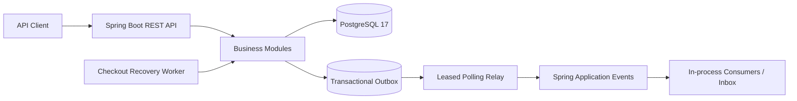
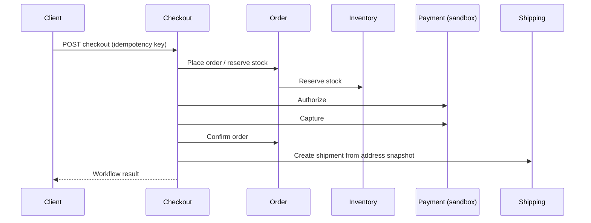

# Architecture Overview

## 1. System intent

Enterprise Order Management (EOM) demonstrates an enterprise-oriented **modular monolith** for customer, catalog, inventory, ordering, payment, shipping, and checkout workflows. The design optimizes for explicit domain ownership, transactional correctness, testability, and a credible path to later extraction—not for maximizing the number of deployable services.

## 2. Runtime context

- One Spring Boot application (Java 25).
- Spring Modulith verifies module boundaries.
- PostgreSQL 17 is the system of record; Flyway owns schema evolution.
- Docker Compose provides the local database.
- GitHub Actions runs Maven verification against PostgreSQL.
- Payment and carrier integrations are deterministic local sandbox implementations; no external provider is contacted.



## 3. Module map and ownership

| Module | Owns | Public collaboration surface |
|---|---|---|
| customer | Customer identity/profile | Customer module API |
| catalog | Product, SKU, price | Catalog module API |
| inventory | Stock and reservation lifecycle | Inventory operations |
| order | Order, line snapshots, order state | Order operations, transactional lifecycle events, and confirmation/cancellation guard ports |
| payment | Payment intent and payment state machine | Payment operations plus adapters for the order guard ports |
| shipping | Shipment and delivery-address snapshot | Shipping operations; validates confirmed orders through the order API |
| outbox | Event envelope, relay metadata, inbox deduplication | Append/publish operations |
| checkout | Durable checkout workflow and orchestration | Checkout API |
| operations | Operator action audit history | Operator audit query API |

Each module owns its persistence. A module must not query another module's repository or tables. Cross-module calls use the owning module's public API; asynchronous integration uses versioned event envelopes. Spring Modulith verification is part of CI.

## 4. Core workflows

### Direct order lifecycle

1. Validate customer and product references.
2. Reserve inventory atomically.
3. Persist order and immutable line/price snapshots.
4. Confirm consumes reservations; cancellation releases them.
5. Repeated terminal commands are handled idempotently where supported.

### Checkout saga



The workflow persists checkpoints and an immutable delivery-address snapshot. Every checkpoint update is committed with its versioned outbox event in the same short PostgreSQL transaction; row-level locks serialize competing workflow updates. The checkout orchestrator itself does not wrap the full saga in one transaction. The default payment mode invokes the deterministic sandbox adapter synchronously inside a payment transaction/row lock. An opt-in `app.payment.command-execution.enabled=true` mode is already wired through AUTHORIZE/CAPTURE/VOID/REFUND: it persists each command with a stable idempotency key, commits the claim, performs gateway I/O outside the transaction, and applies the outcome in a separate lease-guarded transaction. Provider exceptions become UNKNOWN and are never blindly retried. Reconciliation receives the expected amount/currency from the persisted payment intent so a provider adapter can validate the financial context. This is a safe extension point, not a live PSP integration: the repository has no real provider adapter, authoritative provider lookup bean or signed webhook endpoint. Shipping currently uses only a deterministic local adapter; a remote carrier client must likewise be kept outside database transactions and given durable idempotency/reconciliation. Payment-step failure attempts void/release compensation. Order-confirmation failure after capture attempts refund and reservation resolution. Shipment creation failure does not reverse completed payment or inventory actions: the workflow remains fulfillment-pending and the recovery worker retries using the persisted address snapshot. A failed compensation becomes `COMPENSATION_REQUIRED` and requires operator reconciliation; it is not silently treated as success.

**Important financial boundary:** the shipped adapter is sandbox-only. The opt-in split-phase command workflow and UNKNOWN-state handling are implemented, and provider reconciliation receives the expected persisted amount and currency. No live provider adapter or authoritative lookup is installed. A provider timeout in a real integration represents an unknown outcome and must be reconciled by provider reference/idempotency key before any retry. See [Payment Gateway Integration](PAYMENT-GATEWAY-INTEGRATION.md) for the adapter contract and prerequisites before enabling a live PSP.

## 5. Transactional outbox

Business state and event rows are appended in the same PostgreSQL transaction. A scheduled relay claims bounded batches with `FOR UPDATE SKIP LOCKED`, assigns a worker ID and 120-second lease, then publishes outside the claim transaction. This avoids holding row locks while listeners run and lets concurrent instances claim different rows.

- Batch size: 50 in the scheduled relay (claim API accepts 1–500).
- Lease duration: 120 seconds.
- Poll interval: configurable; default 1,000 ms.
- Retry: exponential backoff, starting at 2 seconds and capped at 1 hour.
- Dead-letter: after 12 failed attempts; rows are excluded from automatic claims.
- Expired leases become eligible for recovery.
- Inbox uniqueness is scoped by consumer and event ID; an atomic `INSERT ... ON CONFLICT DO NOTHING` claim prevents concurrent deliveries from invoking the same consumer handler twice.

Delivery is **at least once**, not exactly once. A process can publish an event and crash before saving its published marker. A lease can also expire during unusually slow publication. Consumers must therefore deduplicate and make their business effects idempotent. The current transport is Spring's in-process event publisher, not Kafka/RabbitMQ.

### Operational query

```sql
SELECT event_id, event_type, aggregate_type, aggregate_id,
       attempts, last_error, locked_by, locked_until, dead_lettered_at
FROM messaging.outbox_events
WHERE dead_lettered_at IS NOT NULL
ORDER BY dead_lettered_at DESC;
```

Use this query for inspection only. Do not manually mark events published or replay them without confirming consumer idempotency and the original business outcome.

## 6. Consistency and failure boundaries

| Boundary | Mechanism | Guarantee / limitation |
|---|---|---|
| Order + inventory | One local PostgreSQL transaction | Atomic within this database |
| Order state + order event | Same local transaction | OrderPlaced/OrderConfirmed/OrderCancelled cannot be lost between commit and event append |
| Business write + outbox append | Same local transaction | No lost event due to a DB commit/publish gap |
| Outbox → in-process listener | Leased polling | At-least-once; duplicates possible |
| Consumer effect + inbox marker | Atomic inbox claim + same consumer transaction | Concurrent duplicates are rejected; handler failure rolls back the claim |
| Checkout across modules | Persisted saga checkpoints | Eventual consistency; compensation may need reconciliation |
| Payment/carrier | Sandbox adapters | No real external side effect currently |

## 7. Quality attributes and trade-offs

- **Consistency:** local ACID transactions are preferred inside the modular monolith; saga compensation is used across workflow steps. Payment authorization is bound to the locked order total, active payments are unique per order, and cancellation is guarded until payment is voided/refunded. Shipping requires a confirmed order and an immutable matching destination. Checkout and shipment event versions are monotonic and are backfilled from existing outbox history during migration.
- **Resilience:** retries, leases, dead-letter state, idempotency keys, payment operation UNKNOWN/reconciliation states, expired-lease monitoring, Prometheus alert rules and operator runbooks cover selected failure modes; production provider recovery remains unverified.
- **Maintainability:** module ownership and Spring Modulith checks discourage accidental coupling.
- **Scalability:** database-backed relay claims can be shared by multiple application instances, but throughput and ordering guarantees have not been benchmarked.
- **Operability:** the operator desk can page live records, reconcile compensation, and replay dead letters. Checkout compensation and dead-letter replay actions are recorded with the authenticated actor, outcome, target, and timestamp; history is searchable through an operations-admin-only API. Alerts and external log/trace correlation remain deployment responsibilities.
- **Security:** the API is an OAuth2 resource server for WSO2 access tokens and scope checks. No real payment credentials or cardholder data are used. Rate limiting, secret rotation, and a deployment threat-model review remain open.

## 8. Deliberate non-goals / production gaps

This repository is a portfolio-grade reference implementation, **not a production-ready commerce platform**. Before production use, address at least:

1. Real PSP/carrier adapters with provider-side outcome reconciliation and security review.
2. Metrics, tracing, alerting, and runbooks for relay lag, retries, DLQ, and saga age.
4. Load, soak, concurrency, and multi-instance failure testing under realistic workload.
5. Rate limiting, secret rotation, privacy/data-retention review, and deployment hardening.

## 9. Key decisions

See [ADR-0001](ADR-0001-payment-shipping-outbox-saga.md) for the rationale and compensation matrix.


## Split-phase payment and shipping execution

- Payment command execution and provider reconciliation use persisted operations, stable idempotency keys, bounded leases, and explicit UNKNOWN handling. The worker supplies the persisted payment amount and currency to the provider lookup port; the deterministic sandbox adapter implements the lookup contract in-memory and never treats missing state after restart as authoritative NOT_FOUND.
- Shipment creation persists a PENDING shipment and outbox event. Carrier label creation runs in a separate leased worker outside the database transaction, with bounded retries and a stable shipment-ID idempotency key. See [shipping label workflow](shipping-label-workflow.md).
- Both adapters remain deterministic sandboxes. Production PSP/carrier implementations must supply durable provider-side idempotency and lookup/reconciliation contracts.
